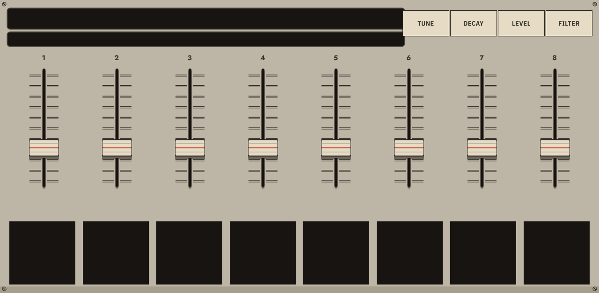

# Potential1200

**That late-80s 12-bit drum sound, on your MPC.** Eight faders, eight pads and the gritty, punchy character of the classic 12-bit sampler that built a whole era of hip-hop, from your own one-shots or a chopped break.

*Instrument plugin · MPC OS 3.x · Gen1 and Gen2 · v1.0.0*

Free and open source (MIT), made by **PotentialBreaks**. It runs inside the MPC like its own instruments, with its own touchscreen pages, Q-Link control and project recall, and no computer needed while you play.

**[Download the latest release](../../releases/latest)** · [Install guide](INSTALL-GUIDE.md) · [FAQ](FAQ.md) · [Ideas and bugs](../../issues/new/choose)

Potential1200 is an independent project. It isn't made by, or connected with, the makers of the original hardware.

## The sound

Every sound goes through the same steps the old machine used:

- **Sampled at 26.04 kHz with no filter in front.** The highs that don't fit fold back down as grit and ring. That's a big part of the sound.
- **Kept as 12 bits.** Quiet tails get grainy, and the loud parts hit hard.
- **Drop-sample pitch.** Tuning a pad up plays it faster and shorter, tuning it down plays it slower and longer and dirtier, just like the original. There's no smoothing between samples.
- **One sample clock for the whole machine**, so every pad has the same stepped, slightly ringing top end.
- **The filters**: pads 1-2 start on a **DYNAMIC** 4-pole low-pass you set per pad, pads 3-6 on the **FIXED** low-pass, and pads 7-8 with the filter **OFF**. Change any pad on the PROGRAM page.
- **The 45 > 33 trick** (SETUP): the sound is sampled as if played at 45 rpm, then slowed back to 33. Same pitch and length, but fewer samples, so it's darker and crunchier.
- **STRETCH** (per pad): keeps a pad's length when you tune it, with the grainy, stuttery time-stretch character, not a clean modern one.
- **Mono mix**, one sound per pad at a time, and **choke groups**.
- **CHARACTER: CLEAN** switches all of it off so you can hear the difference.

## The pages

- **PERFORM**: 8 faders for the 8 pads. Tap **TUNE**, **DECAY**, **LEVEL** or **FILTER** and the faders jump to that setting of every pad. The Q-Links move the faders. Tap a pad below them to hear it and select it.
- **PROGRAM**: everything for the selected pad: tune, decay, level, cutoff, filter type, **STRETCH**, **REVERSE**, choke group, and **START** / **END** trim.
- **KIT**: where the sounds come from.
  - **ONE-SHOTS**: each pad has a type (kick, snare, hat, open hat, clap, perc, tom, cymbal). The arrows step through sounds of that type, and **L** locks a pad.
  - **BREAK**: a break from your library cut across the 8 pads, **ON THE BEAT** or **ON THE HITS**. **TEMPO** plays it **AS IS**, matched to your project the old way (**MATCH (TUNE)**: faster is higher), or with **MATCH (STRETCH)** to keep the pitch. **RANDOM BREAK**, **PREV**, **NEXT**, **LIBRARY**, **PLAY WHOLE BREAK** and **SHUFFLE PADS** are there too.
  - **NEW KIT** puts new sounds on every unlocked pad. **ROLL** changes sounds and settings: **MILD**, **MEDIUM** or **WILD**. **UNLOCK ALL** frees every pad.
- **SETUP**: sample speed (33 or 45 > 33), character (12-bit or clean), pads 9-16, **SAVE KIT**, **RESCAN**, and the **LOOK**.
- **MANUAL**: the manual on the MPC's screen.

**Pads 9-16** play the selected pad at 0, 2, 3, 5, 7, 8, 10 and 12 semitones (**MULTI PITCH**), the classic way to play a sound as a melody. In BREAK mode, the pad after pad 16 plays the whole break.

**SAVE KIT** turns the 8 pads into a real **MPC drum program**: each pad saved as a WAV exactly as you hear it (12-bit, tuned, filtered, trimmed), in `Potential1200/Kits` on your drive. Load it like any program and keep it after the plugin is gone. MPC OS 3.10.1 or later.

Your project remembers the sounds, the break and every setting.

## Where it finds your sounds

You don't have to type any paths.

**One-shots**, in this order:

1. **A `DRUM ONE SHOTS` folder** at the top of any drive. **MPC TOOLS** makes one for you from every sound on your MPC with **MAKE DRUM FOLDER** (Plugins tab), sorted into Kicks, Snares, Hats and so on.
2. **Folders you list yourself** in `Potential1200/folders.txt` on a drive, one per line (a full path, or a folder on that drive).
3. Otherwise, the **drum sounds in your Expansions and Samples** folders, picked out by name.

**Breaks**: a folder called **`DRUM BREAKS LIBRARY`** at the top of a drive, or any top-level folder with "break" in its name. Each sub-folder is a library you can step through with **LIBRARY**.

WAV, AIFF, FLAC and MP3 files are read. After adding sounds, tap **RESCAN** on the SETUP page.

## Four looks

**Vintage** (the default: warm grey panel, cream keys, amber display), **Print Plate**, **Night Rack** and **Colour Block**. Tap one on the SETUP page. The new look shows the next time the plugin loads: take it off the track and add it again, or load your project again. Your choice is kept on your MPC for every project.

## Will it work on my MPC?

| | |
|---|---|
| **Should work on** | Any standalone MPC on **MPC OS 3.10.1 or later**: 32-bit (One, One+, Live, Live II, X, Key 61, Key 37) and 64-bit (Live III, XL, One Gen 2, Key 37 Gen 2). Also Gen1 MPCs on older MPC OS 3.x with the community set-up |
| **Not supported** | **MPC OS 2.x** |

This is the first release. If you try it, please [tell me how it went](../../issues/new/choose).

## Install

The [install guide](INSTALL-GUIDE.md) goes through it step by step. In short, on MPC OS 3.10.1 or later: download `Potential1200-<version>-akai-vst2.zip`, unzip it, and copy the **PotentialBreaks - VST - Potential1200** folder into a **VST2 Plugins** folder at the top of a drive. Restart the MPC, and it's under **External Plugins**.

## Limitations

- **Only the first 3 minutes of a file are read**, to keep the MPC's memory safe.
- **One sound per pad at a time, and a mono mix.** That's how the original worked.
- **The chop is a best guess.** On busy or swung breaks a slice may miss a hit. Try the other CHOP mode.
- **The pads map like a keyboard.** If pad 1 doesn't play pad 1, check the pad bank and octave on the plugin track: the plugin listens to notes 36-51 (and 0-15).
- **SAVE KIT** needs MPC OS 3.10.1 or later to load the program it writes.

## Part of the PotentialSuite

The full [PotentialSuite manual](https://github.com/PotentialBreakfast/potential-plugins/blob/main/MANUAL.md) covers every plugin. [MPC TOOLS](https://github.com/PotentialBreakfast/mpc-tools) installs and updates them from your computer.

[Build it yourself](BUILD.md) · [Contributing](CONTRIBUTING.md) · [Third-party code](THIRD_PARTY.md) · [Changelog](CHANGELOG.md)
